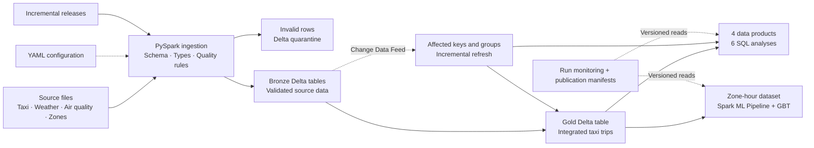

<div align="center">

# Urban Data Platform

**English** | [简体中文](README.zh-CN.md)

### From raw city data to trusted analytics and machine learning

**9.55M taxi trips · 4 source domains · 4 assignments · One end-to-end data platform**


[Assignments](#assignments) · [Architecture](docs/ARCHITECTURE.md) · [Runbook](docs/RUNBOOK.md) · [Reports & Evidence](docs/README.md)

</div>

A city data platform built for **ID2221 Data-Intensive Computing**. It brings NYC taxi trips, weather observations, air-quality measurements and taxi-zone references into **PySpark + Delta Lake**, then builds quality controls, optimized SQL analytics, incremental maintenance, failure recovery and hourly taxi-demand modelling on the same foundation.

The engineering extends beyond a successful pipeline run: optimizations are checked for result equivalence, publications record table versions, and machine learning reuses the platform's validated data.

## Tech stack at a glance

| Layer | Technologies | What they do here |
| --- | --- | --- |
| Distributed processing engine | Python 3.12, PySpark 4.0.4, Java 17 | Multi-source reads, cleaning, joins, aggregation and batch processing |
| Lake storage | Delta Lake 4.0.1, Parquet | Partitioned tables, transactional commits, `MERGE`, versioned reads and Change Data Feed |
| Analytics & optimization | Spark SQL, Cache, Partition Pruning, Broadcast Join, AQE | Six analyses, materialized data products and execution-plan comparisons |
| Incremental reliability | Delta CDF, publication manifests, quarantine tables | Idempotent replay, affected-group refresh and recovery after failures |
| Machine learning | Spark ML `Pipeline`, `GBTRegressor` | Feature preparation, chronological splits, training, evaluation and model persistence |
| Configuration & verification | YAML, JSON, SHA-256, pytest | Declarative quality rules, input checks, regression coverage and real Delta fault tests |

<a id="assignments"></a>

## Four assignments, one evolving platform

| Assignment | Core question | Implementation & deliverables |
| --- | --- | --- |
| **Week 1 · Data Foundation** | How do heterogeneous city files become consistent data assets? | Configuration-driven ingestion; normalized types, names and UTC timestamps; quality checks; Bronze / Gold layers; storage-partitioning experiments. [Design](docs/DESIGN_REPORT.md) · [Benchmark](docs/BENCHMARK_REPORT.md) |
| **Week 2 · Analytics & Performance** | How can millions of trips support reusable, efficient analysis? | Six Spark SQL analyses and four Delta data products; isolated cache, pruning, broadcast and AQE experiments; retained SQL, plans and complete results. [Design](docs/Lab2_Design_Report.md) · [Evaluation](docs/Lab2_Benchmark_Report.md) |
| **Week 3 · Incremental & Reliable** | How do changing data and interrupted runs reach a correct published state? | Deterministic update generation; idempotent `MERGE`; CDF-driven Gold and product refresh; additive schema evolution, quarantine, version publication and four monitoring queries. [Design](docs/Lab3_Design_Report.md) · [Evaluation](docs/Lab3_Evaluation_Report.md) |
| **Week 4 · ML on Trusted Data** | What does the data-engineering layer contribute to modelling? | A zone × hour demand grid retaining zero-trip hours; persisted features and GBT model; chronological evaluation; raw-file versus platform-data comparison. [Design](docs/Week4_Design_Report.md) · [Evaluation](docs/Week4_Evaluation_Report.md) |

### Week 1 — Ingest the files, align their meaning

The inputs include **9,554,778 taxi trips**, hourly weather, air-quality observations and a zone reference table. A shared ingestion framework reconciles formats, types, timezones and missing values before enriching trips with location and environmental context.

Source-specific differences live in configuration and transformation functions; the common pipeline handles reading, validation, writes and metadata. Explore the [data catalog](docs/DATA_CATALOG.md) and [ingestion module](src/urban_platform/ingestion/).

### Week 2 — Turn repeated queries into reusable data products

Six analyses cover monthly demand by zone, weather and trip distance, air quality and demand, demand variation across weather conditions, peak hours and monthly trends. Four materialized products summarize daily mobility, taxi zones, weather impact and air-quality impact.

Optimization checks cover **results, schemas and execution plans**, with warm-ups, three measured runs and retained outputs. Explore the [SQL](sql/) and [individual experiment records](evidence/benchmarks/).

### Week 3 — Give updates, retries and publication explicit semantics

The update release contains **716,608 new trips** and **143,322 exact duplicate trips**, alongside new environmental hours, historical corrections and additive fields. The platform distinguishes inserts, corrections, duplicates and rejected rows, writing invalid records to quarantine.

Publication manifests identify readable table versions; CDF recovers pending changes since the last successful publication. Tests inject failures after Gold or product commits and compare retries and cross-batch recovery against full recomputation. Explore the [incremental runner](src/urban_platform/incremental/) and [recovery tests](tests/test_week3_recovery.py).

### Week 4 — Let models inherit the platform's quality controls

A published Gold snapshot produces **571,613 zone-hour samples**, with **58.7% zero-demand hours**. Categorical indexing, median imputation, temporal features, vector assembly and scaling are saved together with the GBT regressor as one `PipelineModel`.

Training, validation and testing follow chronological order. The raw-versus-platform comparison also demonstrates a practical risk: a model can train successfully even when its demand labels have bypassed quality checks. Explore the [ML module](src/urban_platform/ml/) and [dataset SQL](sql/ml/zone_hour_demand.sql).

## Results with evidence

| Result | Value | Evidence & conditions |
| --- | ---: | --- |
| Q4 weather-variation query speedup | **18.96×** | 1.7122 s → 0.0903 s; Week 2 local experiment, median of three measured runs, using a prebuilt data product. [Raw measurements](evidence/benchmarks/query_04_weather_variation/measurements.json) |
| Broadcast zone-join speedup | **3.18×** | 0.9799 s → 0.3082 s; isolated technique comparison. [Raw measurements](evidence/benchmarks/technique_broadcast/measurements.json) |
| Incremental/full result equivalence | **2 paired trials** | Gold fingerprints, all four products and all six queries compared; monitoring-on/off controls also retained. [Evaluation](docs/Lab3_Evaluation_Report.md) |
| Chronologically held-out test performance | **RMSE 33.58 · R² 0.580** | GBT on the strict bootstrap baseline; test window 2024-03-21 through 03-31. [Evaluation](docs/Week4_Evaluation_Report.md) |

Query speedups exclude product construction and refresh costs. These local results do not establish cluster-scale gains. Week 3 also found that broad zone corrections expanded the incremental workload and made the measured incremental path slower than a full rebuild; the report retains that result and the observed timing variation to explain the trade-off.

## Platform architecture



The [architecture guide](docs/ARCHITECTURE.md) explains storage layers, publication and recovery boundaries. The project uses **Bronze / Gold** layers; original files remain in a read-only input directory.

## Quick start

Run these commands from the repository root in **Windows PowerShell**. You need Python 3.12, network access and the course-provided source files; raw data is not included in Git. The setup script prepares local Java 17, Windows Hadoop compatibility files and Python dependencies.

```powershell
git clone https://github.com/waku-hoomi/Data-Intensive-Computing.git
cd Data-Intensive-Computing

Set-ExecutionPolicy -Scope Process Bypass
.\scripts\setup_windows.ps1 -PythonExe "C:\path\to\python.exe"
& .\.venv\Scripts\python.exe .\scripts\prepare_local_data.py "D:\path\to\course-files"
& .\.venv\Scripts\python.exe .\scripts\check_environment.py
```

In a fresh environment, create the strictly validated historical baseline before building the demand model:

```powershell
# Bootstrap rebuilds historical tables; use only for initialization or an intentional rebuild.
& .\.venv\Scripts\python.exe .\scripts\run_week3_pipeline.py --bootstrap --run-id demo-baseline
& .\.venv\Scripts\python.exe .\scripts\run_ml_dataset.py
& .\.venv\Scripts\python.exe .\scripts\run_ml_train.py --run-id demo-ml
```

Defaults are `local[4]`, 4 GB driver memory and eight shuffle partitions. See the [full runbook](docs/RUNBOOK.md) for input requirements, incremental releases, controlled evaluation, reports and packaging. To reproduce the Week 4 report, use a bootstrap baseline before applying an incremental release.

```powershell
# Small synthetic fixtures and real local Delta tables; no full course inputs required.
& .\.venv\Scripts\python.exe -m pytest tests -q
```

## Repository map

```text
config/                 Dataset contracts, quality rules, analytics and ML settings
src/urban_platform/     Ingestion, integration, analytics, incremental, monitoring, simulation, ML
sql/                    Analyses, optimized queries, data products, monitoring and ML SQL
scripts/                Run, validate, evaluate, generate reports and package submissions
tests/                  Correctness, quality, recovery and ML tests
docs/                   Architecture, runbook, assignment designs and evaluations
reports/                PDF / Word submission reports
evidence/               Week 2 SQL, plans, outputs and measurement snapshots
artifacts/week3/        Committed Week 3 evaluation and recovery evidence
```

Git ignores raw inputs in `dataset/`, generated `data/`, local runtimes, caches and new run outputs. Process notes live in [docs/archive/](docs/archive/); the [documentation index](docs/README.md) links reports and implementation details.

## Scope

This is a course engineering project using real city data, validated on local Spark. Recovery assumes a single writer and available Delta/CDF history. The weather source's timezone is unconfirmed and currently interpreted as UTC; environmental analyses describe association. The demand model uses environmental observations from the corresponding hour; online prediction would additionally need features available at prediction time and a deployment workflow.
