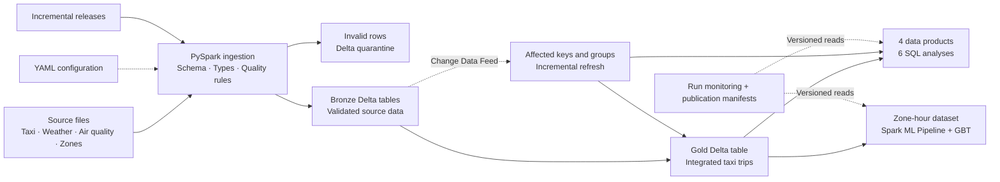

<div align="center">

# Urban Data Platform

[English](README.md) | **简体中文**

### 从城市原始数据，到可信分析，再到机器学习

**9.55M 出租车记录 · 4 类数据源 · 4 次作业 · 一条完整的数据工程链路**


[作业总览](#assignments) · [架构](docs/ARCHITECTURE.md) · [运行指南](docs/RUNBOOK.md) · [报告与证据](docs/README.md)

</div>

基于 **ID2221 Data-Intensive Computing** 课程构建的城市数据平台。项目将纽约出租车行程、天气、空气质量与出租车区域信息整合进 **PySpark + Delta Lake**，逐步实现数据质量治理、SQL 性能优化、增量维护、失败恢复与区域小时级需求预测。

重点不仅是把数据跑通：每一次优化都有结果一致性检查，每一次发布都有版本记录，机器学习复用同一套经过验证的数据基础。

## 一眼看懂技术栈

| 层次 | 技术 | 在项目中解决的问题 |
| --- | --- | --- |
| 分布式计算引擎 | Python 3.12、PySpark 4.0.4、Java 17 | 多源读取、清洗、关联、聚合与批处理 |
| 数据湖存储 | Delta Lake 4.0.1、Parquet | 分区表、事务提交、`MERGE`、版本读取与 Change Data Feed |
| 分析与调优 | Spark SQL、Cache、Partition Pruning、Broadcast Join、AQE | 六类业务分析、物化数据产品与执行计划对照 |
| 增量与可靠性 | Delta CDF、发布版本清单、隔离表 | 幂等回放、受影响分组刷新、失败后恢复 |
| 机器学习 | Spark ML `Pipeline`、`GBTRegressor` | 特征处理、时间划分、训练、评估与模型持久化 |
| 配置与验证 | YAML、JSON、SHA-256、pytest | 声明式质量规则、输入校验、回归与真实 Delta 故障测试 |

<a id="assignments"></a>

## 四次作业，一条演进路线

| 作业 | 核心问题 | 实现与交付 |
| --- | --- | --- |
| **Week 1 · Data Foundation** | 如何把异构城市数据变成统一的数据资产？ | 配置驱动的通用摄取框架；统一类型、命名与 UTC 时间；质量检查；Bronze / Gold 分层；存储分区实验。[设计](docs/DESIGN_REPORT.md) · [实验](docs/BENCHMARK_REPORT.md) |
| **Week 2 · Analytics & Performance** | 如何让千万级行程数据支持可复用的分析？ | 六条 Spark SQL 分析、四个 Delta 数据产品；独立对照缓存、分区裁剪、广播连接与 AQE；保存 SQL、执行计划与完整结果。[设计](docs/Lab2_Design_Report.md) · [评估](docs/Lab2_Benchmark_Report.md) |
| **Week 3 · Incremental & Reliable** | 数据不断变化，如何正确更新并从中断中恢复？ | 确定性更新生成器；幂等 `MERGE`；CDF 驱动的 Gold 与产品刷新；Schema 扩展、无效行隔离、版本发布和四类运行监控。[设计](docs/Lab3_Design_Report.md) · [评估](docs/Lab3_Evaluation_Report.md) |
| **Week 4 · ML on Trusted Data** | 数据工程能为模型提供什么？ | 区域 × 小时需求网格，保留零订单时段；特征与 GBT 模型统一持久化；按时间划分训练与测试；对比从原始文件建模与复用平台数据。[设计](docs/Week4_Design_Report.md) · [评估](docs/Week4_Evaluation_Report.md) |

### Week 1 — 把数据接进来，更要把语义对齐

原始输入包含 **9,554,778 条出租车行程**、小时天气、空气质量观测和区域字典。通过统一的摄取框架处理不同文件格式、字段类型、时区与缺失值，再将区域、天气和空气质量关联到行程。

数据源差异集中在配置与转换函数，通用流程负责读取、验证、写入与元数据记录。详见[数据目录](docs/DATA_CATALOG.md)和[摄取模块](src/urban_platform/ingestion/)。

### Week 2 — 从重复查询，到可维护的数据产品

六类分析覆盖区域月度需求、天气与距离、空气质量与需求、天气下的需求变化、高峰时段和月度趋势。四个物化产品提供日常出行、区域统计、天气影响与空气质量影响的可复用汇总。

调优同时检查**结果、Schema 与执行计划**，保留预热、三次计时与原始结果，而不是只记录一个耗时数字。详见 [SQL](sql/) 和[逐项实验记录](evidence/benchmarks/)。

### Week 3 — 让更新、重试与发布都有明确语义

更新批次包含 **716,608 条新增行程**和 **143,322 条精确重复行程**，同时加入环境数据新小时、历史修正和新增字段。平台区分新增、修正、重复与拒绝数据，并将无效行写入隔离表。

发布清单记录可读取的表版本；CDF 帮助恢复上次成功发布以来的待处理变化。测试在 Gold 或产品提交后注入失败，检查重试、跨批次恢复与全量重算是否一致。详见[增量编排](src/urban_platform/incremental/)和[恢复测试](tests/test_week3_recovery.py)。

### Week 4 — 让模型继承数据平台的质量控制

基于已发布 Gold 快照构建 **571,613 条区域小时样本**，其中 **58.7% 为零需求时段**。使用类别索引、中位数填补、时间特征、向量组装和标准化，将特征处理与 GBT 回归器保存为同一个 `PipelineModel`。

训练、验证与测试按时间先后划分。原始数据与平台数据的对照还展示了一个实际问题：模型能够正常训练，并不代表它使用的需求标签已经通过质量检查。详见 [ML 模块](src/urban_platform/ml/)和[数据集 SQL](sql/ml/zone_hour_demand.sql)。

## 用证据说明成果

| 结果 | 数值 | 对应证据与条件 |
| --- | ---: | --- |
| 天气变化分析 Q4 的查询加速 | **18.96×** | 1.7122 s → 0.0903 s；Week 2 本地实验、三次计时中位数，使用预先构建的数据产品。[原始测量](evidence/benchmarks/query_04_weather_variation/measurements.json) |
| 广播区域表连接加速 | **3.18×** | 0.9799 s → 0.3082 s；独立技术对照实验。[原始测量](evidence/benchmarks/technique_broadcast/measurements.json) |
| 增量结果与全量重算一致 | **2 轮对照** | 比较 Gold 指纹、四个产品与六条查询；同时保留监控开关对照。[评估](docs/Lab3_Evaluation_Report.md) |
| 按时间留出的测试集表现 | **RMSE 33.58 · R² 0.580** | GBT，严格 bootstrap 基线，2024-03-21 至 03-31 测试窗口。[评估](docs/Week4_Evaluation_Report.md) |

查询加速不包含产品构建与刷新成本；这些是本地运行结果，不能直接推算集群收益。Week 3 的实验也发现，大范围区域修正会扩大增量影响面，所测增量流程慢于全量重建——项目保留了这一结果及原始波动，便于讨论策略取舍。

## 平台架构



[架构详解](docs/ARCHITECTURE.md)介绍数据分层、版本发布与恢复边界。项目使用 **Bronze / Gold** 两层；原始文件保存在只读输入目录。

## 快速开始

以下命令在仓库根目录的 **Windows PowerShell** 中执行。需要 Python 3.12、网络连接，以及课程提供的原始数据；原始数据不包含在 Git 仓库中。首次安装脚本会准备本地 Java 17、Windows Hadoop 兼容文件和 Python 依赖。

```powershell
git clone https://github.com/waku-hoomi/Data-Intensive-Computing.git
cd Data-Intensive-Computing

Set-ExecutionPolicy -Scope Process Bypass
.\scripts\setup_windows.ps1 -PythonExe "C:\path\to\python.exe"
& .\.venv\Scripts\python.exe .\scripts\prepare_local_data.py "D:\path\to\course-files"
& .\.venv\Scripts\python.exe .\scripts\check_environment.py
```

新环境先构建经过严格验证的历史基线，再运行需求建模：

```powershell
# Bootstrap 会重建历史表；仅在初始化或有意重建时运行。
& .\.venv\Scripts\python.exe .\scripts\run_week3_pipeline.py --bootstrap --run-id demo-baseline
& .\.venv\Scripts\python.exe .\scripts\run_ml_dataset.py
& .\.venv\Scripts\python.exe .\scripts\run_ml_train.py --run-id demo-ml
```

默认运行配置为 `local[4]`、4 GB driver memory、8 个 shuffle partitions。输入清单、增量发布、受控评估、报告生成和打包步骤见[完整运行指南](docs/RUNBOOK.md)。复现 Week 4 报告时使用尚未应用增量发布的 bootstrap 基线。

```powershell
# 小规模合成数据与真实本地 Delta 表测试；不依赖完整课程输入。
& .\.venv\Scripts\python.exe -m pytest tests -q
```

## 仓库导航

```text
config/                 数据源、质量规则、分析与 ML 配置
src/urban_platform/     摄取、集成、分析、增量、监控、模拟与 ML
sql/                    业务查询、优化查询、数据产品、监控与 ML SQL
scripts/                运行、验证、评估、报告与打包入口
tests/                  正确性、质量控制、恢复与 ML 测试
docs/                   架构、运行指南、逐周设计与评估
reports/                PDF / Word 提交报告
evidence/               Week 2 SQL、计划、结果与测量快照
artifacts/week3/        已提交的 Week 3 评估与恢复证据
```

原始输入 `dataset/`、运行生成的 `data/`、本地运行时、缓存与新增运行产物由 Git 忽略。过程记录集中在 [docs/archive/](docs/archive/)，完整资料索引见 [docs/README.md](docs/README.md)。

## 适用范围

这是基于真实城市数据的课程工程项目，当前验证环境为本地 Spark。恢复流程假设单写入者且所需 Delta / CDF 历史仍然可用；天气源时区未获确认，当前按 UTC 解释；环境与出行分析表达相关性。需求模型使用对应小时的环境观测，面向在线预测时仍需补充预测时可获得的特征与部署流程。
