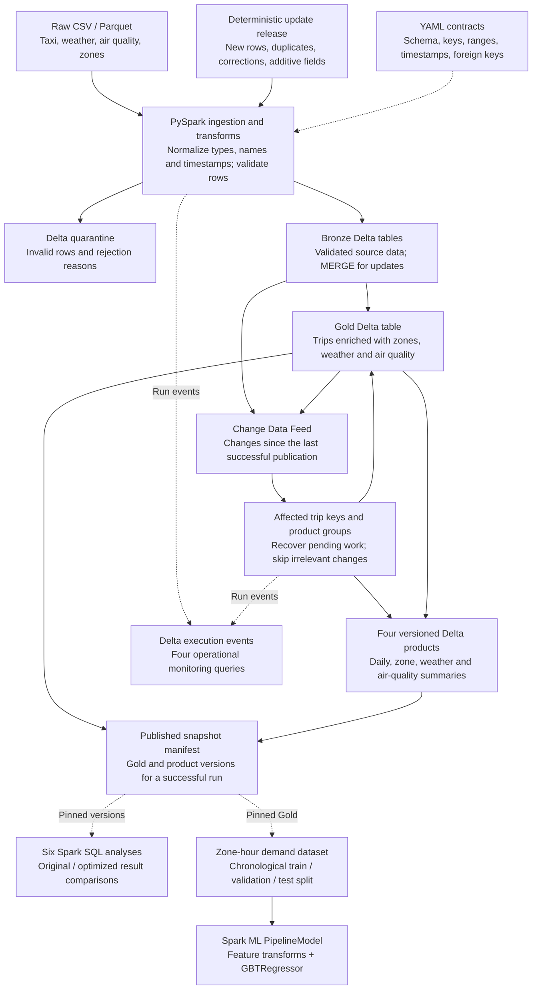
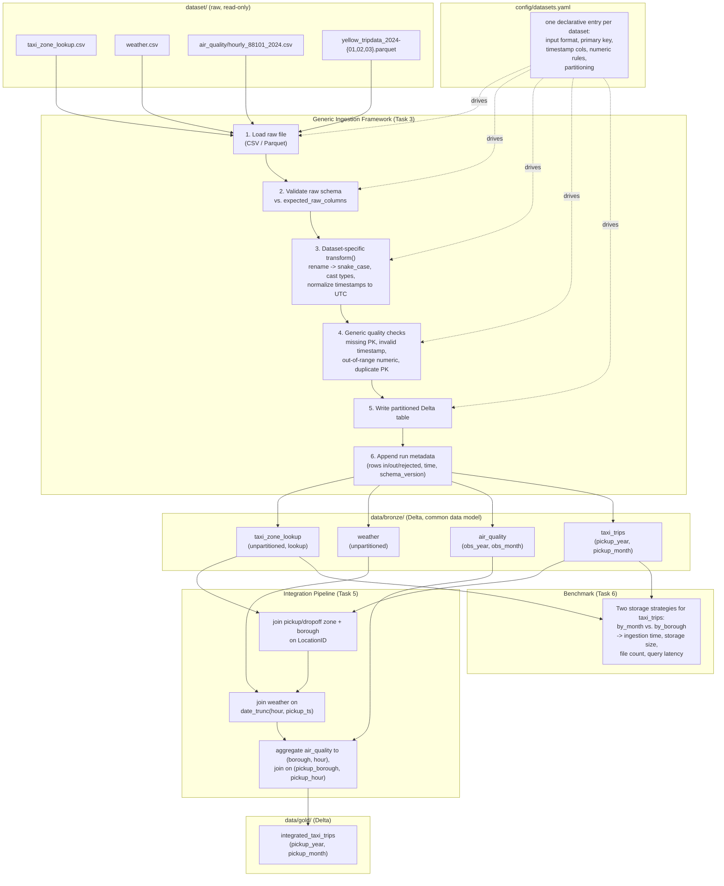

# Platform Architecture

[Project overview](../README.md) · [Runbook](RUNBOOK.md) · [Documentation index](README.md)

The platform grows from source integration in Week 1 to SQL products in Week 2,
incremental maintenance in Week 3 and demand modelling in Week 4. It runs on local
Spark with Delta Lake; raw source files remain read-only.

## Current platform: Weeks 1–4

### Data and read boundaries

| Location | Responsibility |
| --- | --- |
| `dataset/` | Original course files; preparation checks the input manifest and records provenance. |
| `data/bronze/` | Standardized and quality-checked source tables. This project uses Bronze / Gold without a separate Silver layer. |
| `data/gold/` | Integrated trips; UTC storage, New York local-time analysis. |
| `data/products/` | Reusable daily mobility, zone statistics, weather impact and air-quality impact summaries. |
| `data/monitoring/` | Execution events and publication manifests containing table versions. |
| `data/quarantine/` | Per-run rejected rows with reasons. |
| `data/ml/` | Training datasets and persisted feature/model pipelines. |
| `evidence/`, `artifacts/week3/` | Committed experiment snapshots; new runtime outputs remain local. |

Analytical readers resolve the latest successful publication and read the recorded
versions. Individual Delta table commits are transactional; the publication
manifest provides the reader's cross-table snapshot boundary. It does not make
all underlying table writes a single multi-table transaction.

### Incremental refresh and recovery

Bronze updates use dataset-specific keys: taxi IDs are full-row hashes, while
weather, air quality and zone keys support corrections. An altered taxi payload
cannot reliably be identified as a correction without a source trip ID.

CDF recovers changes since the last successful publication, including earlier
pending changes when another batch arrives. The runner propagates affected keys
to Gold and recomputes the necessary product groups. Weather products are fully
rebuilt when the analysis window changes their observed-hour denominator.
Successful duplicate replay leaves the analytical state unchanged.

If an update fails after a table commit, readers retain the previous published
versions while a retry completes pending work. Recovery assumes **one writer**,
available source files and retained Delta/CDF history. See the
[runner](../src/urban_platform/incremental/runner.py),
[publication module](../src/urban_platform/monitoring/publication.py) and
[fault-injection tests](../tests/test_week3_recovery.py).

### ML as a downstream consumer

The demand dataset reuses the platform's analysis views and pinned Gold reads.
It preserves zero-demand zone-hours and uses fixed chronological split dates.
Feature transformations and `GBTRegressor` are fitted and saved as one
`PipelineModel`. The published Week 4 results use a strict bootstrap baseline
before incremental updates; additive humidity/AQI columns are unavailable on
that baseline and are excluded from model features. See the
[ML design report](Week4_Design_Report.md).

## Historical Week 1 ingestion diagram

The original diagram below describes the initial full-load design. Its pipeline
ends at Gold and the storage benchmark; use the current diagram above for the
Week 2–4 extensions. Later validation rules and incremental behavior supersede
the initial ingestion assumptions.

## Reading this diagram

- **Left to right / top to bottom is the data flow**: raw files never move or
  mutate — every stage reads its input and writes a new artifact.
- **`config/datasets.yaml` drives the entire ingestion box** — none of the five
  ingestion steps hardcode a dataset name; they all read their behavior
  (which columns to expect, how to partition, what counts as invalid) from
  this one file, dispatching to a small per-dataset transform function only
  at step 3.
- **Bronze is the boundary where the common data model becomes true.** Every
  bronze table, regardless of source format or naming convention, is
  guaranteed to have `snake_case` columns, UTC timestamps, and NULL (never
  sentinel) missing values from this point on.
- **Gold is derived, not authoritative.** `integrated_taxi_trips` can always be
  rebuilt from bronze; it exists purely to save downstream analytical queries
  (Week 2) from repeating the same three joins.
